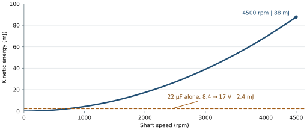

# Reaction Wheel Controller

This KiCad 10 controller for the Bleps spacecraft fits the shaft face of one Faulhaber 2610T012B. Its internal rotor provides the angular momentum. Open [Rotor.kicad_pro](Rotor.kicad_pro) and follow the sheets from the spacecraft harness through CAN, control, and the three-phase bridge to the motor ribbon.

[Schematic PDF](review/Reaction-Wheel-Controller-schematic.pdf) · [Assembly STEP](review/Reaction-Wheel-Controller-assembly.step) · [Mounted assembly](review/Reaction-Wheel-Controller-assembly.png) · [Mounting profile](review/Reaction-Wheel-Controller-mounting-profile.png) · [Shaft-facing PCB](review/Reaction-Wheel-Controller-shaft-face.png) · [Motor-facing PCB](review/Reaction-Wheel-Controller-motor-face.png)

The motor-facing silkscreen carries *Waterline Eclipse*. The upper fish crosses the waterline beneath the six probe pads. The crescent beside the Ø6.40 mm shaft opening and the aqueduct share the right side. The fine engraving was simplified for a single ink layer, and the artwork is selectable as one group in KiCad. The four spacer seats and the two rear current-sense channels have clear space around them. [Printed layout render](review/Reaction-Wheel-Controller-motor-face.png) · [Original artwork](review/art-concepts/Anableps-Waterline-Eclipse.png) · [1:1 mechanical artwork proof](review/art-concepts/Anableps-Waterline-Eclipse.svg)

## Mechanical and harness interface

The 26 × 26 mm board matches the square flange with 1.5 mm corner radii. Four Ø2.2 mm nonplated PCB holes align with the motor’s Ø2.1 mm holes on a Ø30 mm circle. The Ø6.4 mm aperture gives 0.2 mm nominal radial clearance around the Ø6 mm pilot. Install four 2.5 mm-high, Ø4 mm spacers between the motor flange and PCB underside to retain the shaft datum. Use M2 through-fasteners in the flange clearance holes. The nominal 7 mm shaft projection leaves 2.9 mm above the 1.6 mm PCB. Check the actual spacer and screw dimensions, screwdriver access for the two Gecko jackscrews, ribbon strain relief and free shaft rotation before tightening. For operation in vacuum, confirm the ordered bearing lubricant. Faulhaber lists Y4192 as a separate vacuum option. [Faulhaber dimensional drawing and options](https://eshop.faulhaber.com/media/0a/d7/d4/1775629787/EN_2610_B_DFF.pdf)

| Connection | Signals in numbered order |
| --- | --- |
| J201 spacecraft, 6-way Gecko-SL | 1 protected 2S VBATT, 2 GND, 3 CAN_H, 4 regulated 3.3 V, 5 GND, 6 CAN_L |
| J301 motor ribbon | 1 phase C, 2 phase B, 3 phase A, 4 GND, 5 Hall 3.3 V, 6 Hall C, 7 Hall B, 8 Hall A |

The P2 harness supplies separate motor and logic rails. VBATT feeds the three-phase bridge. Spacecraft 3.3 V feeds the logic, the current-sense reference and the Hall sensors. The 2610…B digital Hall supply range is 2.2–20 V. Their open-drain outputs have 3.3 kΩ pull-ups to the same 3.3 V rail. Use the six-contact Gecko-SL G125-MS10605M1R vertical plug and G125-2240696F1 cable housing. The two M2 female threads accept the cable screws on the shaft-facing side. Allow 9.95 mm above the board for the mated connector, plus wire bend and tool clearance. Each supply uses one contact. Both ground contacts are available for the return. Follow Harwin’s mating-face numbering when building this harness. [Harwin board connector](https://www.harwin.com/products/G125-MS10605M1R) · [Harwin cable housing](https://www.harwin.com/products/G125-2240696F1) · [Faulhaber AN163, table 4](https://www.faulhaber.com/fileadmin/Import/Media/AN163_EN.pdf#page=3)

## PCB construction and assembly

The shaft-facing side carries the MCU, MRAM, CAN transceiver, screw-lock harness connector and motor bridge. The motor-facing side carries two matched sensing channels, each with one amplifier, shunt and bypass capacitor. The rear amplifier package is at most 1.10 mm tall, leaving 1.40 mm nominal clearance to the flat motor flange with the 2.50 mm spacers. Both shunts face the bridge phase outputs. All four Kelvin pickup pairs have a 1.65 mm pad-center span before routing. The PCB has six copper layers and a nominal thickness of 1.60 mm. L2 provides a ground reference, L5 distributes 3.3 V, and a dedicated VBATT pour supplies the motor bridge. The harness input retains a 22 µF capacitor on each supply, C212 on logic and C301 at the motor bridge. U100 retains its local core regulator, inductor and bypass capacitors.

Board Setup contains JLCPCB’s JLC06161H-3313 six-layer, 1.6 mm FR-4 stack with ENIG. From L1 to L6, the five dielectric thicknesses are 0.0994 / 0.5500 / 0.1088 / 0.5500 / 0.0994 mm. The outer copper is 35 µm and inner copper is 15.2 µm. The placement revision has no trace segments or vias. The filled power and ground zones establish plane intent for routing. Internal planes still require connections. [JLCPCB stackups](https://jlcpcb.com/impedance) · [JLCPCB manufacturing capabilities](https://jlcpcb.com/capabilities/pcb-capabilities/)

Install the KiCad 10 standard 3D model libraries for the native viewer. The project includes additional models for the Faulhaber motor, spacers, Gecko and custom packages. The Gecko model represents the unmated connector envelope. The standalone assembly STEP includes the populated PCB, spacers and motor.

## Bench bring-up

1. **Verify power and recovery.** With the bridge asleep, verify spacecraft 3.3 V at TP102 and between J301.5 and J301.4, then verify VBATT at C301. Exercise both rail startup orders and loss of each rail. Verify that MCU reset and logic-rail loss pull U301 nSLEEP low and leave the phase outputs high impedance. R301 holds nSLEEP low through 3.3 kΩ. On RP2350 A2 keep the GP21 input buffer disabled when using it as an output and scope nSLEEP through reset. Check the loaded logic rail against the RP2350’s 3.135 V analog-supply minimum. U102 trips at 3.08 V nominal, so a slow sag can cross that supply limit before reset. Confirm the EPS rail tolerance and shutdown behavior. Probe RUN_N at TP104 during a slow power ramp and a watchdog reset. Probe the bare rear row before attaching the controller to its motor. Its C/D/V/G/R/W legend denotes SWCLK, SWDIO, 3.3 V reference, GND, RUN and watchdog inhibit respectively. Ground TP201 (W) during SWD programming. For the running watchdog, provide falling WDI edges within the 1.44 s minimum timeout. Stop servicing WDI and verify the nominal 200 ms reset pulse and return to bridge sleep. [TPS3435-Q1 timing](https://www.ti.com/lit/ds/symlink/tps3435-q1.pdf)
2. **Validate boot with the motor installed.** Fit the image in 512 KiB and put a bootable IMAGE_DEF in the first 4 KiB. A writer running from SRAM can issue WREN (06h), WRITE (02h) and READ (03h) to verify the image. Configure QMI for 03h single-SPI reads with 24-bit addresses. Set a conservative flash clock divider from SRAM before increasing the system clock and follow the RP2350 QMI clock-change sequence. Verify SCK ≤40 MHz, CS high ≥40 ns, setup and hold ≥10 ns, and first CS low ≥400 µs after the MRAM reaches 3.0 V. Exercise cold power-up, brownout and watchdog restart. Measure three-axis field magnitude at the U101 site through one revolution, first unpowered and then under load. Everspin’s read/standby and write absolute maximum is 12,000 A/m, approximately 15.1 mT in air. Confirm margin including probe uncertainty before relying on direct MRAM boot. [RP2350 §5.2.7](https://pip-assets.raspberrypi.com/categories/1214-rp2350/documents/RP-008373-DS-4-rp2350-datasheet.pdf) · [Everspin tables 6, 12 and 14](https://www.everspin.com/sites/default/files/EST00459_MR2xH40_Datasheet_Rev12.6_08092020.pdf)
3. **Establish commutation.** Turn the shaft by hand, log all six legal Hall states in both directions, and measure phase order and electrical zero. Estimate rotor angle between Hall edges and define startup and reversal behavior at low speed. Wake U301, wait 3 ms and use SPI mode 1 with parity. Start with 40 kHz center-aligned PWM for the low-inductance winding. Use GP20 as the carrier reference with PWM_OSC_SYNC = 2h. A 64-clock three-duty write at 5 MHz takes 12.8 µs of the 25 µs carrier period. The current loop can update every other period. Scope when the new duties take effect, find a settled interval for both ADC samples, and verify ripple and winding temperature. Sample GP26 and GP27 after PWM common-mode transients settle, account for conversion skew, and reconstruct phase C as −(A+B). Calibrate polarity, zero and gain against independent bidirectional phase-current references before closing the loop. GP28 provides an integrated phase C cross-check when its low-side FET conducts. Enable the integrated amplifier and measure its zero with the rotor stationary and all low-side FETs on. [Faulhaber Hall sequence](https://www.faulhaber.com/fileadmin/Import/Media/AN163_EN.pdf) · [Faulhaber PWM guidance](https://www.faulhaber.com/fileadmin/Import/Media/AN190_EN.pdf#page=3) · [DRV8311-Q1 PWM synchronization, current sensing and tSPI](https://www.ti.com/lit/ds/symlink/drv8311-q1.pdf)
4. **Exercise the vehicle interface.** Drive Classical CAN through PIO on GP2 TX and GP3 RX. Match the vehicle bitrate, terminate the two bus ends, and verify bidirectional traffic, arbitration, bus-off recovery and bridge behavior after command loss. Read TMP100-Q1 at 7-bit I²C address 0x48. Its measurement is local PCB temperature. The motor’s 177 mA DC-equivalent continuous rating assumes 22 °C ambient and the catalog thermal mounting condition. Qualify the phase-current limit from measured winding temperature on the assembled motor. The winding limit is 80 °C. [SN65HVD233](https://www.ti.com/product/SN65HVD233) · [Faulhaber motor ratings](https://eshop.faulhaber.com/media/0a/d7/d4/1775629787/EN_2610_B_DFF.pdf)

## Slew torque and phase-current sensitivity

The 2 kg Bleps cavity model has a largest principal inertia of 0.00496250 kg·m². From a standstill, one wheel on that axis must exchange 86.6 µN·m·s to reach 1°/s or 173.2 µN·m·s to reach 2°/s. The bare rotor needs speed changes of approximately 1,047 and 2,094 rpm. The table shows the acceleration component of current using the catalog torque constant of 17.6 mN·m/A. Add bearing losses, external torque and commutation error as applicable. [Faulhaber 2610T012B motor constants](https://eshop.faulhaber.com/en/2610T012B/2610T012B)

| Time to reach rate | 1°/s, DC equivalent | 2°/s, DC equivalent |
| --- | ---: | ---: |
| 0.1 s | 49.2 mA | 98.4 mA |
| 1 s | 4.92 mA | 9.84 mA |
| 2 s | 2.46 mA | 4.92 mA |

Faulhaber defines catalog BLDC current as DC-equivalent. For sinusoidal commutation, multiply by about 1.10 for phase peak or 0.78 for phase RMS. With amplitude-invariant Park scaling and zero d-axis current, q-axis current equals phase peak and the modeled torque constant is about 16.0 mN·m/A of q-axis current. The catalog 177 mA continuous rating corresponds to about 195 mA peak and 138 mA RMS. Measure shaft torque against commanded q-axis current and qualify the winding limit under the actual mounting and ambient conditions. The bridge's ampere-scale overcurrent protection protects the power stage. Apply separate phase-current and thermal limits in firmware. [Faulhaber AN183, p. 12](https://www.faulhaber.com/fileadmin/Import/Media/AN183_EN.pdf#page=12) · [Faulhaber AN190, p. 4](https://www.faulhaber.com/fileadmin/Import/Media/AN190_EN.pdf#page=4) · [TI DRV8311-Q1 electrical characteristics](https://www.ti.com/lit/ds/symlink/drv8311-q1.pdf)

The supplied 8.2 V simulation estimates 61 ms to acquire 2°/s and about 3.04 mA to sustain the rotor at 2,094 rpm against drag. Interpreted as catalog DC-equivalent current, the latter corresponds to about 3.34 mA sinusoidal phase peak and a 16.7 mV peak signal at the current amplifier. Validate both operating points on the bench.

The two inline INA241A3-Q1 channels use 0.100 Ω shunts and gain of 50 V/V, giving 5 mV/mA about midrail. Route a dedicated Kelvin pair from each shunt’s terminals. The amplifier’s maximum 10 µV input offset at 25 °C under specified conditions is equivalent to 0.10 mA. At 3.3 V, the ideal 12-bit ADC step is 0.806 mV or 0.161 mA. Sweep known currents in both directions, including the 3 mA region, and log both sequential ADC samples, PWM timing, Hall angle, estimated q-axis current, speed and temperature. Check warm offset, noise and ripple at the chosen loop bandwidth during acquisition, steady rotation and reversal. Compare measured error to the allocated pointing and jitter budget. A provisional 10% budget at 3 mA DC-equivalent is about 5.3 µN·m. [TI INA241A-Q1](https://www.ti.com/product/INA241A-Q1) · [RP2350 ADC](https://datasheets.raspberrypi.com/rp2350/rp2350-datasheet.pdf)

## Speed envelope to 3000 rpm

At 3000 mechanical rpm, the two pole pairs produce 100 Hz electrical and 600 Hall edges/s, with a mean interval of 1.67 ms. The 12 V catalog operating data use block commutation. The catalog back-EMF constant gives 5.53 V in that convention. Under the sinusoidal model above, the line-to-line peak fundamental is √3 × (2/3) × 0.0160 N·m/A × 314 rad/s, or about 5.81 V. With 14.1 Ω phase-equivalent resistance at 22 °C and linear space-vector PWM, estimated phase-peak current headroom is about 98 mA at the simulation’s 8.2 V and 8 mA at 6.0 V, before harness and bridge drops, winding heating and control margin. The 6.0 V point may support light-load operation with little torque reserve. Measure open-circuit back-EMF versus Hall angle, then map available torque at speed across loaded rail voltage and winding temperature. Check current-loop saturation and define the supported slew rate at the minimum rail. [Faulhaber 2610T012B datasheet](https://eshop.faulhaber.com/media/0a/d7/d4/1775629787/EN_2610_B_DFF.pdf) · [Faulhaber sinusoidal current and torque convention](https://www.faulhaber.com/fileadmin/Import/Media/AN183_EN.pdf#page=12)

## Energy returned during braking

At 3000 rpm the bare rotor carries 0.248 mN·m·s of angular momentum and 39.0 mJ of kinetic energy. The 4500 rpm point in the plot illustrates energy scaling. C301 provides 22 µF nominal bulk capacitance on the direct VBATT-to-MOTOR_VM path. It can absorb only 3.62 mJ between 8.4 V and the driver’s 20 V recommended operating ceiling. The spacecraft electrical power system (EPS) may impose a much lower transient limit. P2 has no onboard brake dump or VM voltage measurement. For regenerative braking, confirm the EPS can absorb returned power at full charge and evaluate cases where protection switches isolate the battery. Provide a validated dissipative path or limit braking to verified operating states if the upstream path cannot absorb the energy. [Faulhaber rotor inertia](https://eshop.faulhaber.com/media/0a/d7/d4/1775629787/EN_2610_B_DFF.pdf) · [DRV8311-Q1 operating range and bulk-capacitance guidance](https://www.ti.com/lit/ds/symlink/drv8311-q1.pdf)

Begin with high-impedance coast on disable and verify that asserting nSLEEP turns off all bridge FETs. Scope MOTOR_VM at C301 with the intended harness and a source with known reverse-current behavior. Exercise shutdown, watchdog reset and supply interruption during rotation. Increase commanded braking progressively and record phase current, bus voltage and stopping torque before testing reversal from 3000 rpm. Repeat across the EPS supply and protection states. [DRV8311-Q1 sleep mode and phase output states](https://www.ti.com/lit/ds/symlink/drv8311-q1.pdf)

